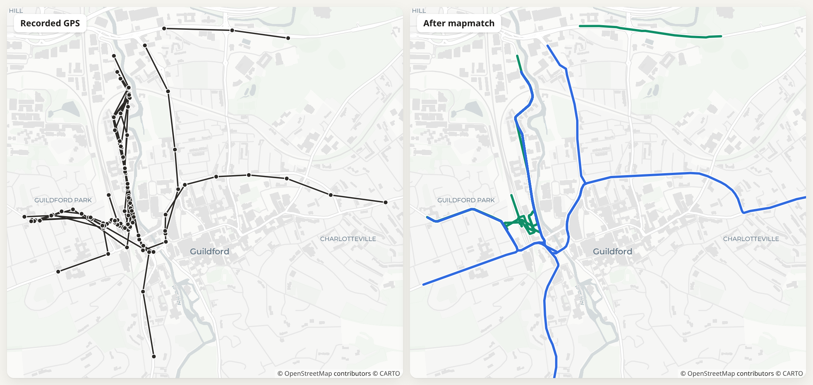

# mapmatch for Dawarich

Phones record GPS a point every few seconds at best, and often far less. In
[Dawarich](https://dawarich.app) that turns into lines cutting across buildings,
corners clipped off every junction, and train journeys drawn as straight
spokes. mapmatch works out how you travelled, snaps each part of the trip to
the road, path or railway you were actually on, and writes the result back into
your Dawarich account. You can check every trip first.



*Drives and rides through Guildford. Left: what the phone recorded. Right: after
mapmatch, coloured by mode (blue driving, green cycling).*

## What it does

- **Finds your trips** in the raw point stream. A trip ends after a long stop
  or a gap in the data, so it doesn't depend on how your phone app grouped
  things.
- **Works out the mode** of each part: walking, cycling, driving, train or a
  stop. One trip can be *cycle → train → cycle*.
- **Matches each part** with the right rules. Driving follows one-way streets.
  Cycling ignores them. Walks and mountain-bike rides only snap to a path when
  the GPS clearly follows it, and the rest stays as recorded. Trains follow the
  rail line.
- **Bridges dropouts.** Where the signal was lost, the gap is routed only when
  the timing makes sense, so a tunnel doesn't turn into a detour.
- **Lets you fix anything** in a web portal. You can:
  - change the mode of any stretch by dragging across the timeline;
  - move or leave out individual points;
  - route or keep each gap;
  - open any earlier version of a trip and go back to it.
- **Runs on its own** if you want. It can download new points on a schedule,
  match them, and push finished trips to Dawarich.

## Your data stays yours

Before mapmatch changes anything in Dawarich, it copies every original point
into its own archive. Nothing in mapmatch ever deletes from that archive.
Pushing a trip replaces its points in Dawarich with the matched route, and
tidies the stops either side of it: the GPS jitter while you were stopped
becomes one point where you were, at arrival, departure and every half hour.
Reverting puts the original points back exactly as they were. You can do that
for one trip, or for all of them with **Revert everything** in Settings.

Even so, **back up your Dawarich database before your first push**. mapmatch
has been tested against a real Dawarich account. Still, it is your location
history, and a backup costs you five minutes.

## What you need

- **Dawarich**, reachable from where mapmatch runs, and an API key for each
  person (Dawarich → Account).
- **Valhalla**, the open-source routing engine, with map tiles for the area you
  travel in. mapmatch asks it which roads and paths fit your GPS. It isn't
  bundled, because tiles are large and specific to your region.
  [docs/deploying.md](docs/deploying.md#valhalla) has the two commands that
  build and serve it.
- **Docker** with one container and one volume. mapmatch keeps everything in a
  single SQLite file, so there's no database server to run.

Train stretches are matched against bundled Great Britain rail lines, so train
journeys elsewhere come out less cleanly.

## Set it up

1. Get the code and the compose file:

   ```bash
   git clone https://github.com/And5666/dawarich-smart-mapmatch.git
   cd dawarich-smart-mapmatch
   cp compose.example.yml compose.yml
   ```

2. Edit `compose.yml`:
   - `DAWARICH_URL`: how the container reaches Dawarich, for example
     `http://dawarich_app:3000` on Dawarich's Docker network.
   - `ADMIN_USER` and `ADMIN_PASSWORD`: your first sign-in.
   - The network name at the bottom: the one your Dawarich containers use
     (`docker network ls`).

   `PUSH_DRY_RUN: "1"` is on to start with. Pushes are planned and logged, but
   Dawarich isn't touched.

3. Start it:

   ```bash
   docker compose up -d --build
   ```

4. Open `http://your-server:8080` and sign in as the admin. Then:
   - **Admin → Map server**: enter your Valhalla address and press **Test**.
   - **Admin → Regions**: note which areas your tiles cover, so everyone knows
     where matching works.
   - **Admin → People**: add an account for anyone else, or let people sign up.

5. Connect Dawarich by pasting your API key. mapmatch downloads your points and
   splits them into trips. Nothing is matched or changed yet.

6. In Dawarich's settings, set **Meters between routes** to `300` and
   **Minutes between routes** to `30`, so Dawarich doesn't draw straight lines
   across stretches your phone didn't record.

7. Press **Match**, look through a few trips, and push one. With dry run on,
   you see what would change. When you're happy, set `PUSH_DRY_RUN: "0"`,
   restart, and push for real.

Behind a reverse proxy, set `PORTAL_BASE_PATH` (for example `/mapmatch`) and
`PORTAL_SECURE_COOKIE: "1"` for https. Back up the `/data` volume: it holds the
archive that reverting relies on.

[docs/deploying.md](docs/deploying.md) covers the details: Valhalla, regions,
accounts for several people, how gaps are handled, and exactly what a push
does in Dawarich.

### Settings

| Variable | Default | |
|---|---|---|
| `DAWARICH_URL` | `http://dawarich_app:3000` | Dawarich as seen from the container (each person can point at their own in Settings) |
| `DAWARICH_HOST_HEADER` | none | Host header to send, if Dawarich only answers to its public name |
| `ADMIN_USER`, `ADMIN_PASSWORD` | `admin`, none | First admin account; ignored once an admin exists |
| `PORTAL_DATA` | `/data` | Database and archive. **Back this up.** |
| `PORTAL_BASE_PATH` | none | e.g. `/mapmatch` when served under a path |
| `PORTAL_SECURE_COOKIE` | `0` | `1` behind https |
| `PUSH_DRY_RUN` | `0` (`1` in the example compose) | `1` plans pushes without changing Dawarich |
| `MATCH_WORKERS` | `4` | Trips matched in parallel; keep at or below Valhalla's thread count |
| `VALHALLA_DATA_DIR` | none | Optional read-only mount of Valhalla's data, so admins can see and download the map files |

Lost the admin password? Run
`docker exec -it mapmatch python -m mapmatch.portal.admin reset <username>`.

## How well it works

Measured on a real account: 280 recorded journeys (15,197 GPS points) over
three months of driving, cycling, walking, hiking in Snowdonia and commuting
by train. The comparison is against the previous version of this project.

| | before | now |
|---|---|---|
| straight-line jumps between matched parts | 720 | 118 |
| lone GPS points left unmatched | 297 | 5 |
| journeys with more than 20 % unmatched | 32 | 8 |
| distance left unmatched | 101 km | 56 km |
| typical worst-case distance from GPS to the line (95th percentile, mean) | 1,094 m | 29 m |

Most of what is still unmatched is bad data: fixes that would mean travelling
at 300–700 km/h, or off-trail walking where no path exists to snap to.

## How it works

For each trip:

1. **Clean.** Duplicates, broken clocks, very inaccurate fixes, spikes and
   short teleports are set aside. They aren't deleted.
2. **Stops.** Places you stayed are found and drawn as a single point. A slow
   scramble, or a pause in the middle of a walk, still counts as walking.
3. **Modes.** Speed from the phone, plus closeness to railway lines, gives each
   stretch a mode. Changes of mode are kept rare, so short blips don't split
   the trip into pieces.
4. **Match.** Each stretch goes to Valhalla with the profile for its mode;
   trains follow the rail lines.
5. **Fill.** Every break goes through one filler: a lost signal, an unmatched
   run, or a change of mode. It tries a route, then a route through the
   recorded points, and otherwise keeps the GPS.
6. **Write.** The result is a timed point stream that slots into Dawarich in
   place of the original points.

## Develop

```bash
uv venv .venv && uv pip install -e '.[dev]'
.venv/bin/pytest                      # engine and portal tests, no network needed
VALHALLA_URL=http://host:8002 .venv/bin/python -m mapmatch.tools.bench \
    --csv your-export.csv --trips auto
PORTAL_DATA=./portal-data .venv/bin/uvicorn mapmatch.portal.app:app --reload --port 8080
```

- `mapmatch/engine/`: the matcher, standard library only (`api.py` is the entry point)
- `mapmatch/portal/`: the web app (`push.py` holds the rules for changing Dawarich)
- `mapmatch/tools/bench.py`: benchmark against a CSV export
- `tests/`: tests with a fake Valhalla and a fake Dawarich
- `docs/deploying.md`: running it for yourself or for several people

Private GPS exports (`data/*.csv`) and the benchmark's Valhalla cache are
git-ignored, because both contain coordinates.
